# CDS-135487 – QA Istio pipelines: before / after screenshots + bugs

Order = QA pipeline list. Not included (QA pe pass): bootstrap5gigk, canarydelegatesvcs0n4h, checkroutingsw7yl.

- **Before** = QA account (`qa.harness.io`), run #1, failed (purana plugin image).
- **After** = local Harness, same QA YAML (sirf service/env/runtime badla), fixed plugin image `harnessdev/temp:k8s-traffic-shift-cds133918-canary`.
- **Error** column QA screenshot ke log se hai. **Fix** column `kubernetes-plugin` branch `fix/CDS-135487-traffic-shift-qa-failures` ke diff se; jahan mapping pakki nahi hai wahan likha hai.

| # | QA pipeline | Before (QA) | After (local) | Before error |
|---|---|---|---|---|
| 1 | canarymergevs7epqs | screenshots/canarymergevs7epqs-before-1.png | pipeline_f592 – screenshots/canarymergevs7epqs-1.png | subset v2 missing, response headers missing, match rules not updated |
| 2 | canarymergeunnamednamedtcpq4se6 | screenshots/canarymergeunnamednamedtcpq4se6-before-1.png | pipeline_83b9 – screenshots/canarymergeunnamednamedtcpq4se6-1.png | Release [releasename-339227] was not found in history |
| 3 | bgmergevsrgnjp | screenshots/bgmergevsrgnjp-before-1.png | pipeline_fea4 – screenshots/bgmergevsrgnjp-1.png | subset stable missing, response headers missing |
| 4 | canarynomatchhostsrjuct | screenshots/canarynomatchhostsrjuct-before-1.png | pipeline_aa3d – screenshots/canarynomatchhostsrjuct-1.png | Harness release-name label missing on new VS |
| 5 | configinheritrtdllmp | screenshots/configinheritrtdllmp-before-1.png | pipeline_ae22 – screenshots/configinheritrtdllmp-1.png | config step Failed (screenshot me error line nahi dikh rahi) |
| 6 | configinheritdelegatesvcagnek | screenshots/configinheritdelegatesvcagnek-before-1.png | pipeline_0d5d – screenshots/configinheritdelegatesvcagnek-1.png | json: cannot unmarshal object into Match.matches.port of type uint32 |
| 7 | configinheritexprz7rvq | screenshots/configinheritexprz7rvq-before-1.png | pipeline_582c – screenshots/configinheritexprz7rvq-1.png | json: cannot unmarshal string into Destination.destinations.weight of type int32 |
| 8 | configinheritznfkj | screenshots/configinheritznfkj-before-1.png | pipeline_8b3b – screenshots/configinheritznfkj-1.png | json: cannot unmarshal object into Match.matches.port of type uint32 |

---

## 1. canarymergevs7epqs
Before: 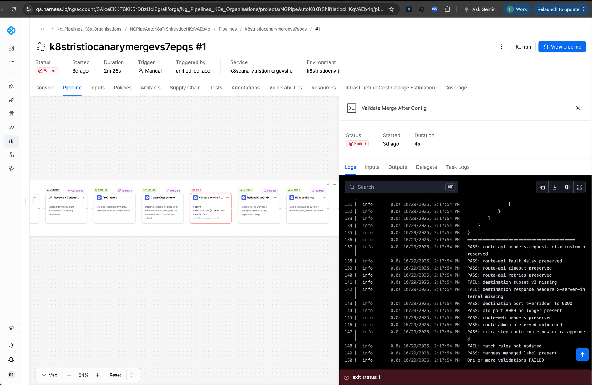
After: 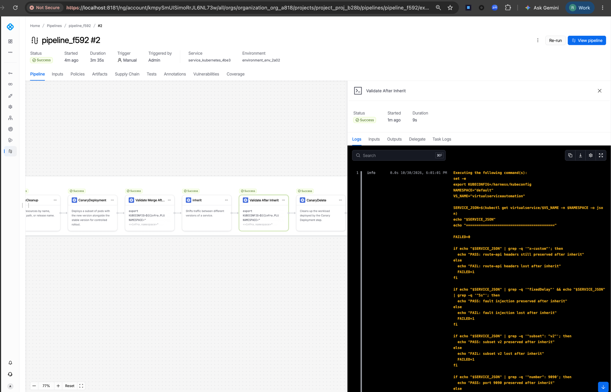

Bug: canary merge ke baad destination ka `subset` (v2) aur response `headers` (x-server-internal) manifest VS se preserve nahi hue; "match rules not updated" bhi fail.
Fix: `GenerateResourcePatches` ab cluster destination ka `Subset` aur `Headers` rakhta hai (sirf weight badalta hai). Host precedence (step -> manifest VS -> stable service) aur canary ke `InProgress` release ka lookup (`resolveTargetRelease`) bhi isi branch me.
"match rules not updated" ka exact fix diff se pakka nahi (anuman: `uri`/`key` alias ya port parsing).

## 2. canarymergeunnamednamedtcpq4se6
Before: 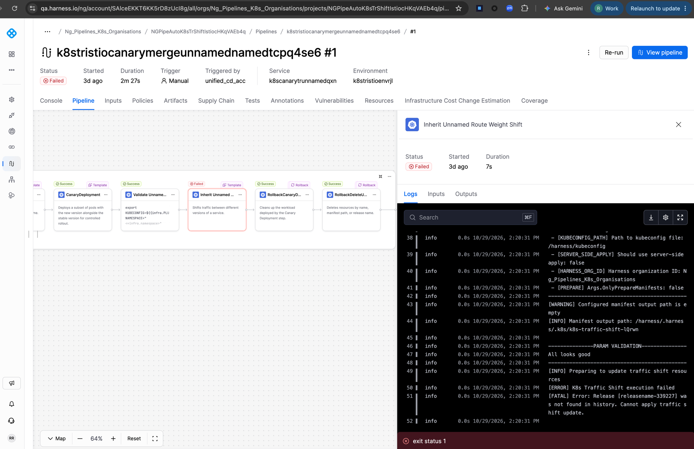
After: 

Bug: Canary ke baad "Inherit Unnamed Route Weight Shift" me `Release [...] was not found in history`. Canary release ko `InProgress` chhodta hai, plugin sirf last successful release dhundta tha.
Fix: `resolveTargetRelease` (in-progress latest release pehle). Saath me manifest VS ke `tcp`/`tls` sections merge me untouched rakhe gaye.

## 3. bgmergevsrgnjp
Before: 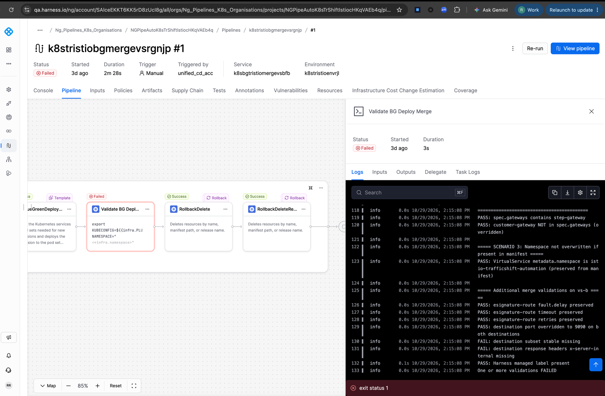
After: 

Bug: BG merge validation me destination `subset stable` aur response `headers x-server-internal` missing.
Fix: destination subset/headers preserve (same as #1). BG swap me `switchTrafficToStable` (`k8s-swap-services-selectors/plugin/swap.go`) bhi add hua.

## 4. canarynomatchhostsrjuct
Before: 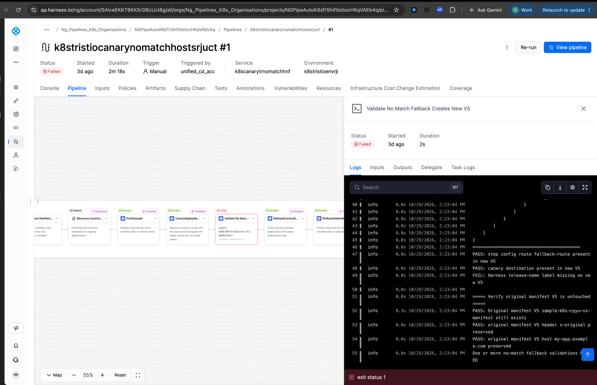
After: 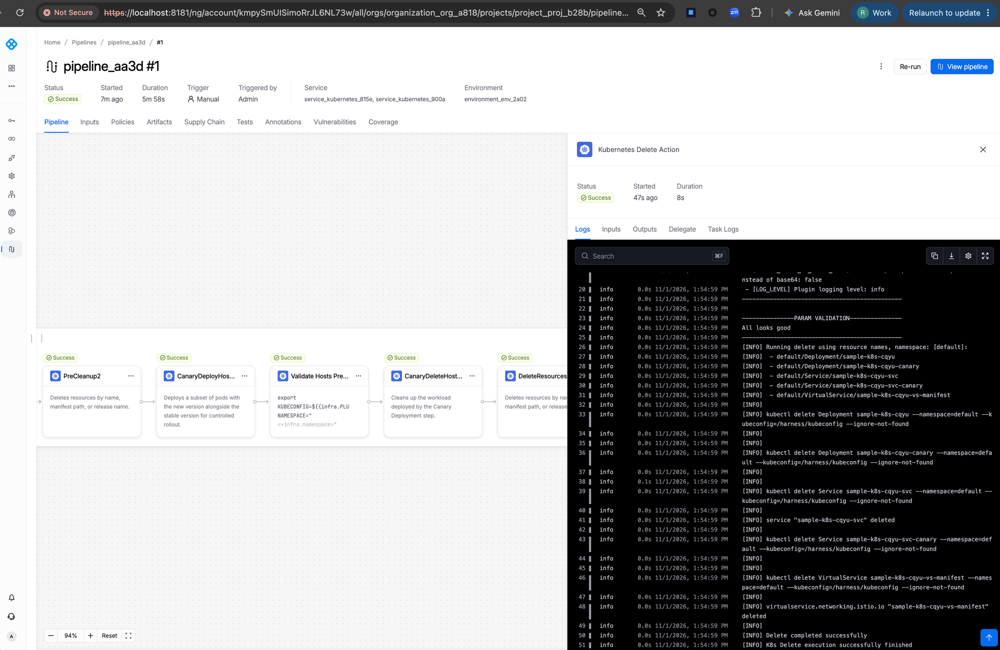

Bug: No-match fallback me naye VS pe Harness release-name label missing (baaki PASS: fallback route, canary destination, original VS untouched).
Fix: ye label wala fix mujhe uncommitted diff me nahi mila; last commits (CDS-135312, "add harness.io/managed on Istio merge") me ho sakta hai. Pakka nahi, check karna baaki hai.

## 5. configinheritrtdllmp
Before: 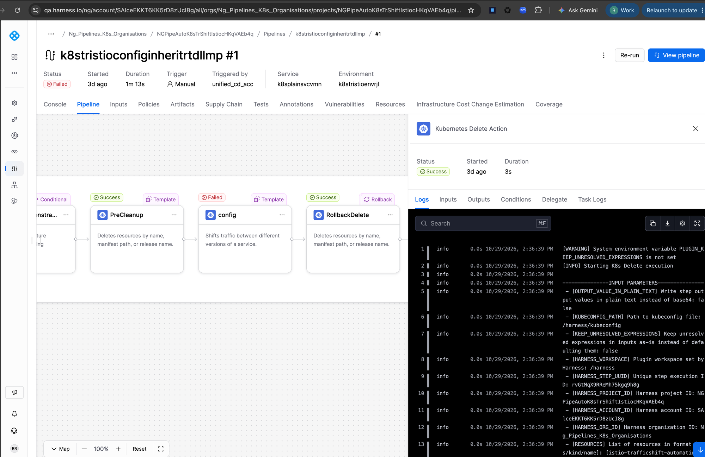
After: 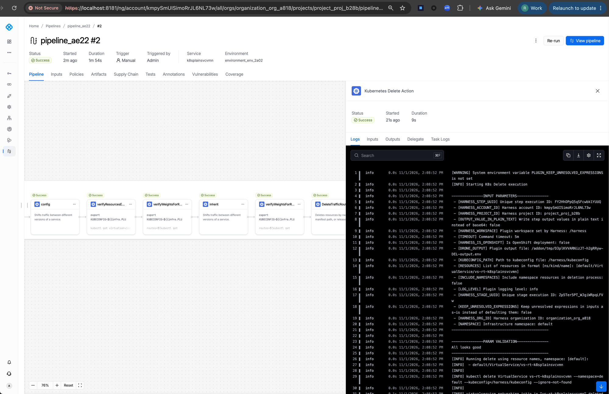

Bug: config step fail. Screenshot me jo log dikh raha hai wo PreCleanup (delete) ka hai, config ki error line nahi dikhti, to exact error confirm nahi.
Fix: pakka nahi. Is pipeline ke QA config-step log se confirm karna hoga.
Note: local run #1 plugin se nahi, run input me inherit weights swapped hone se fail hua tha; #2 pass.

## 6. configinheritdelegatesvcagnek
Before: 
After: 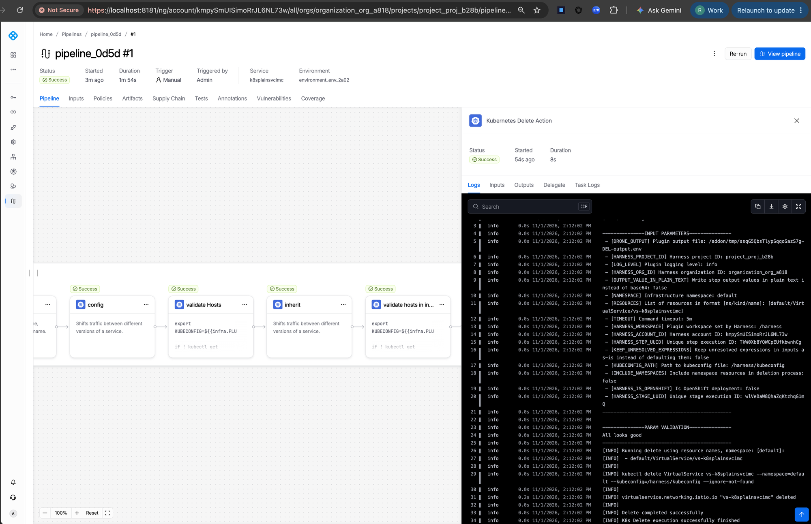

Bug: `json: cannot unmarshal object into Go struct field Match.matches.port of type uint32` – match ka `port` Istio ke `{value: N}` form me aata hai, plugin sirf number leta tha.
Fix: `Match.UnmarshalJSON` – `port` plain number, string ya `{value: N}`, teeno accept (`parseLenientUint32`).

## 7. configinheritexprz7rvq
Before: 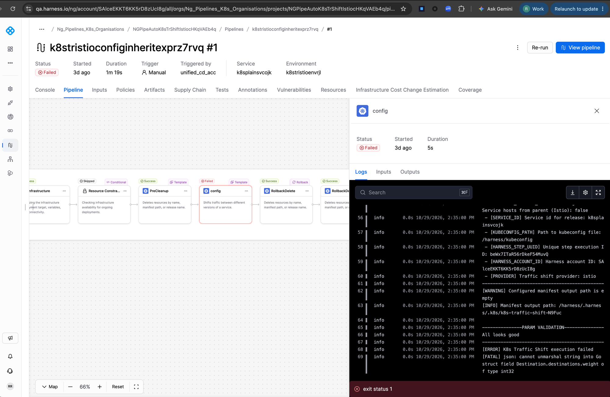
After: 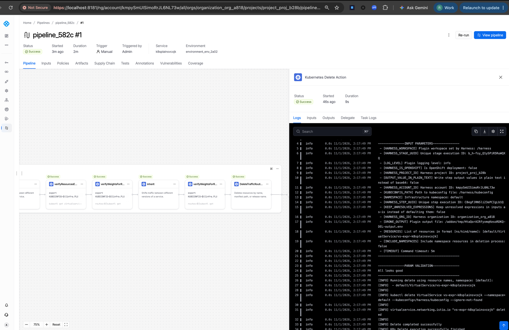

Bug: `json: cannot unmarshal string into Go struct field Destination.destinations.weight of type int32` – pipeline input expressions resolve hoke string (`"65"`) aate hain.
Fix: `Destination.UnmarshalJSON` – `weight`/`port` string, number ya `{value: N}` accept. Saath me `Match.uri` (alias of `path`) aur header `key` (alias of `name`).

## 8. configinheritznfkj
Before: 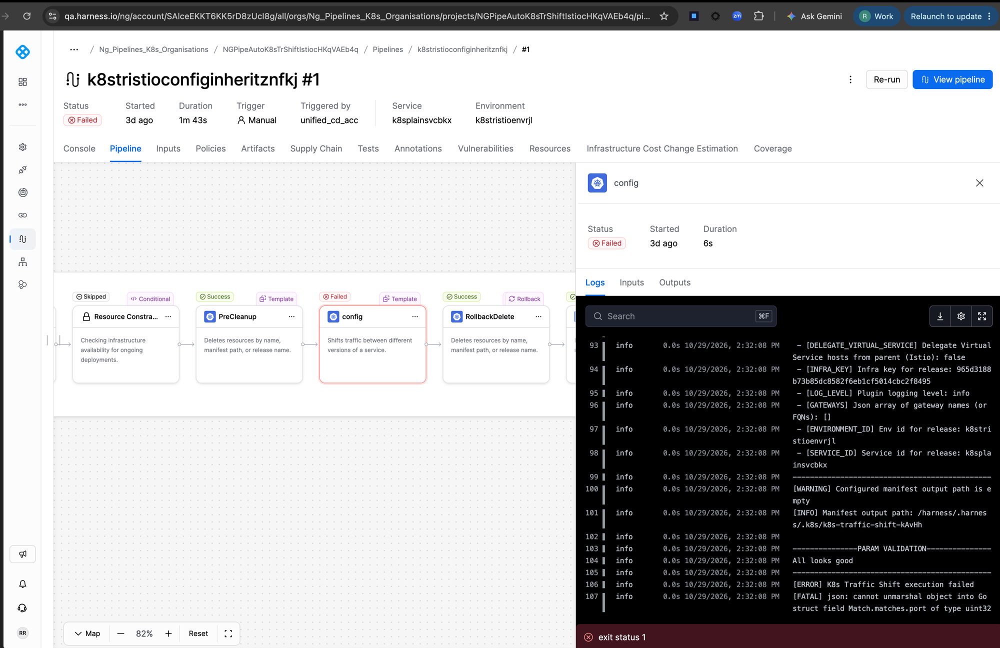
After: 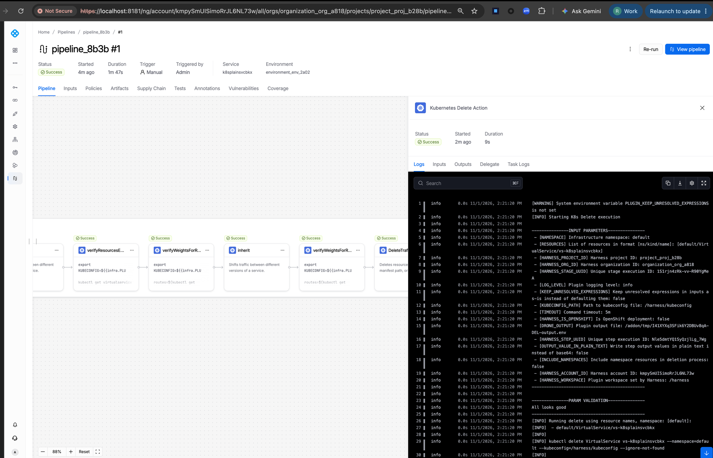

Bug: same as #6 – `Match.matches.port of type uint32` unmarshal error.
Fix: `Match.UnmarshalJSON` lenient port.

---

Alag (is doc me nahi): checkroutingsw7yl ka local rolling `DeployApps` fail local image `harnessdev/k8s-rolling:0.0.1` ke `PLUGIN_`-prefixed outputs ki wajah se hai; QA pe pass.
Weight normalization (Java HashMap order, write-back) aur blank-routes guard bhi branch me hain, par upar ke 8 before-errors me inka seedha ss nahi hai.
